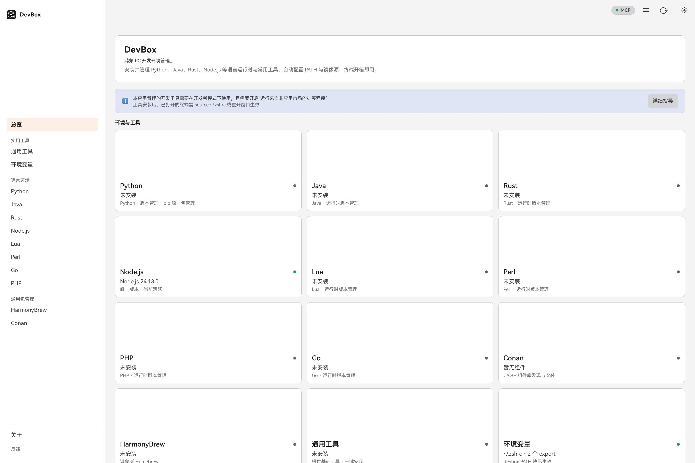
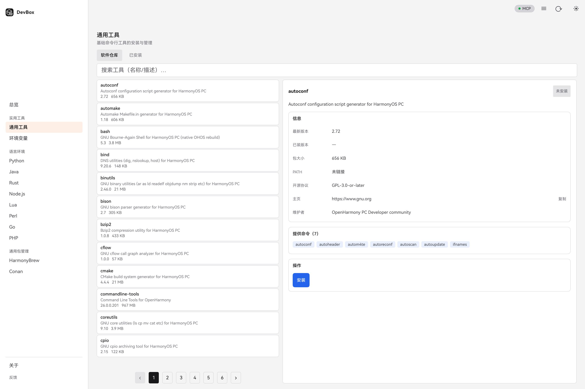
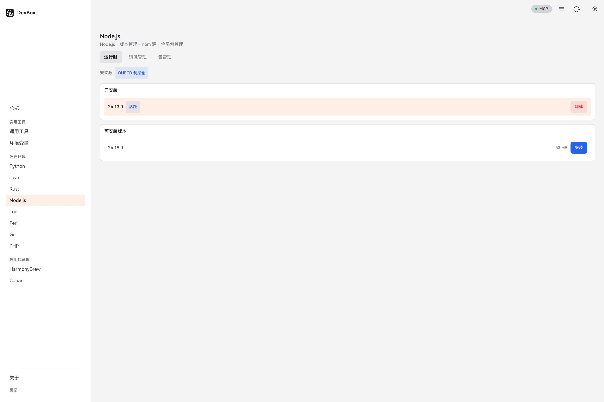
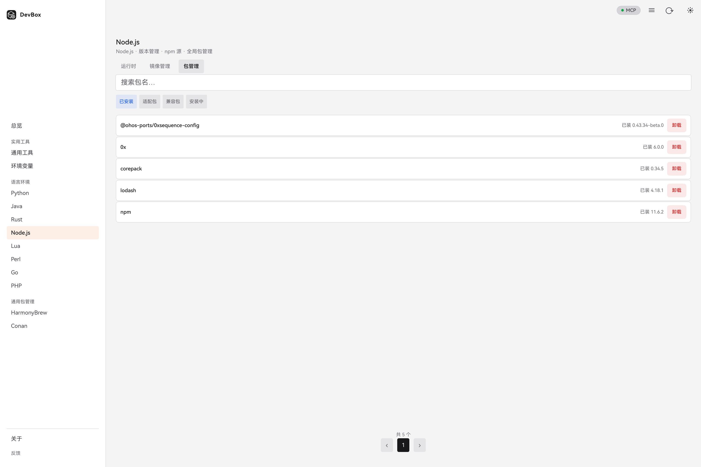

# DevBox —— 鸿蒙 PC 开发环境管理工具

面向 HarmonyOS PC（2in1）的开发者环境管理器：语言运行时、命令行工具、包生态的
安装、多版本切换、卸载与环境配置，全部图形化完成，终端开箱即用。

## 核心能力

- **语言环境**：Python / Java（BiShengJDK）/ Rust / Node.js / Lua / Perl / Go / PHP
  的版本选择、安装、多版本切换、卸载（manifest 声明式协议驱动，安装产物随版本目录隔离、卸载即净）
- **通用工具**：60+ 鸿蒙化命令行工具（git / cmake / ninja / gdb 等）的搜索、安装与依赖展示
- **包生态**：HarmonyBrew（鸿蒙版 Homebrew）、Conan（C/C++ 组件库）、pip / npm 全局包与镜像源管理
- **环境变量**：`.zshrc` / `.bashrc` 的结构化编辑、多文件同步、DevBox 托管块保护
- **MCP 服务**：内置 47 工具的 Model Context Protocol 服务器（本机 18765 端口），
  Claude 等 AI 应用可直接查询与操作开发环境；危险操作强制设备确认
- **环境体检**：运行时 / PATH / 镜像源连通性一键检测与修复引导

## 界面预览

| | |
|---|---|
|  |  |
| *总览：环境健康面板* | *通用工具：60+ 命令行工具* |
|  |  |
| *语言运行时：版本安装与切换* | *包管理：npm 全局包* |

## 快速开始

```bash
# 依赖安装（oh_modules）
ohpm install

# 构建（DevEco Studio 5.1+ / 命令行 hvigorw，SDK API 26）
hvigorw assembleHap --mode module -p module=entry@default -p product=default

# 签名与安装（签名 profile 配置见 DevEco Studio；产物如下）
hdc install -r entry/build/default/outputs/default/entry-default-signed.hap
```

系统要求：HarmonyOS PC（2in1），开发者模式已开启。

## 测试

真机自动化（视觉模板匹配 + MCP 真值双通道）：

```bash
cd test/ui_automation
python run_all.py [workdir] --quick   # L1 冒烟 + L3 边缘
python run_all.py [workdir]           # 全量（含真实安装链路 E2E）
```

## 文档

| 文档 | 内容 |
|---|---|
| [产品需求文档](docs/产品需求文档.md) | 产品定位、功能规格、路线图 |
| [架构设计](docs/架构设计.md) | 分层结构、安装链路、MCP 服务、后台进程、平台约束 |
| [UI 设计规范](docs/UI设计规范.md) | 主题 token、组件体系、布局与交互 |
| [安装协议与制品规范](docs/安装协议与制品规范.md) | 制品方契约：打包校验、manifest action 词表 |
| [权限说明](docs/权限说明.md) | 权限清单、用途与不可替代性 |
| [商用发布范围](docs/商用发布-功能范围.md) | 发布裁剪范围与恢复开关 |
| [反馈提交接口](docs/反馈提交接口文档.md) | 应用内反馈的社区 Issue 提交接口 |

## License

[Mulan PSL-2.0](LICENSE)。三方组件：IBest-UI-V2（MIT）、liblzma/xz（0BSD）——
应用内「关于 → 开源声明」可查看。
